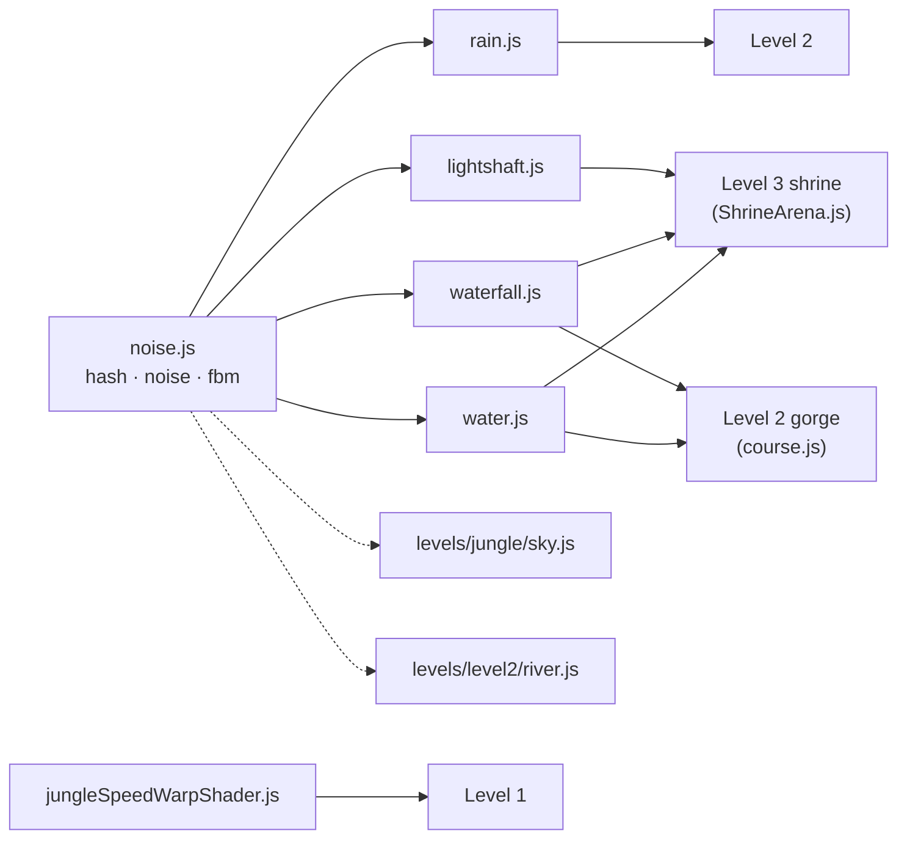

# The `shaders/` folder

Six small files hold the game's custom GPU effects. Each one is a three.js
`ShaderMaterial` with its GLSL vertex and fragment shaders written inline as
JavaScript strings. A level imports a shader, puts it on a mesh, and updates a
few numbers on it every frame.

| File | What you see on screen | Used in |
| --- | --- | --- |
| `noise.js` | Nothing on its own. It is the shared noise library the other shaders build on | water, waterfall, rain, light shafts, plus the sky and the river |
| `jungleSpeedWarpShader.js` | Speed streaks along the edges of the trail | Level 1 |
| `rain.js` | Rain streaks across the camera lens | Level 2 |
| `waterfall.js` | A falling curtain of water with foam | end of Level 2, Level 3 |
| `water.js` | A rippling pool or river surface | end of Level 2, Level 3 |
| `lightshaft.js` | God rays of sunlight with drifting dust | Level 3 |

---

## How every shader works

All six follow the same pattern, so once you understand one, the rest read the
same way.

```
 game code (CPU)                      GPU
 ───────────────                      ───────────────────────────────
 createXMaterial()  ──►  ShaderMaterial
                           ├─ vertex shader    places each vertex on screen
                           ├─ fragment shader  colours each pixel
                           └─ uniforms         inputs from the game
 every frame:
   uniforms.uTime  += dt        ──►  makes it move
   uniforms.uSpeed / uTint ...  ──►  reacts to what's happening in the game
```

1. **A factory function** (`createWaterMaterial()` and so on) builds the
   material and sets default colours. A level calls it once, during setup.
2. **The vertex shader** usually just transforms the vertex to the screen and
   passes the UV or world position on to the fragment shader. The waterfall's
   vertex shader also bends the mesh (see below).
3. **The fragment shader** does the actual work: it combines noise, smooth
   fades and colour mixing to decide each pixel's colour and transparency.
4. **Uniforms** link the game to the shader. Every shader has `uTime`, which
   makes it animate. Most also have one uniform driven by game state, so the
   effect responds to gameplay.

---

## How they connect



- **`noise.js` is the hub.** It exports one GLSL string, `NOISE_GLSL`. The
  other shaders get the functions by string concatenation:
  `NOISE_GLSL + fragmentShader`. GLSL has no `import`, so this is the
  usual way to share code between shaders.
- **The speed-warp shader is the only one that doesn't use noise.** Its
  pattern is built from repeating lines (`fract`) instead.
- **Water and waterfall are a pair.** In Level 3 the waterfall lands in the
  pool, and the pool's foam ring (`uFoamAt`) sits where the water hits.
  The same pair is reused at the end of Level 2, where the car drives
  over the falls.

### Game state → uniform

| Shader | Uniform | Driven by |
| --- | --- | --- |
| Speed warp | `uSpeed` (0–1) | Kai's current speed, so faster running gives more and quicker streaks |
| Rain | `uIntensity` (0–1) | How wet Level 2 has become, so the rain fades in partway through |
| Water | `uTint` (0–1) | Level 3's final phase, when the pool turns blood red |
| Waterfall | `uTint`, and the rate `uTime` grows | Final phase: the fall runs red and flows faster |
| Light shaft | `uStrength` (0–1) | Time of day, so the beams fade out at dusk |

---

## What each file does

### `noise.js`, the shared toolkit
- `hash(p)` returns a pseudo-random number for a grid cell.
- `noise(p)` gives smooth *value noise*: random values at the grid corners,
  blended smoothly in between.
- `fbm(p)` (*fractal Brownian motion*) stacks 5 layers of noise, each with
  twice the detail and half the strength. This gives the natural, cloudy
  look used for water, clouds, foam and dust.

### `jungleSpeedWarpShader.js`, speed streaks (Level 1)
- Two glowing ribbons lie flat along the edges of the path.
- `fract()` cuts each ribbon into repeating cells with a thin line in each.
  The lines scroll with time to make streaks.
- As `uSpeed` goes up, the streaks get faster, thinner, more numerous and
  brighter. At walking speed they disappear.
- Additive blending means it only brightens the trail and never hides it.

### `rain.js`, rain on the lens (Level 2)
- A full-screen quad, drawn in its own overlay scene with an orthographic
  camera, so it sits in front of everything.
- Three layers of noise, squashed to be thin and tall, scroll downwards at
  different speeds (fine streaks, bigger drops, mist).
- A larger, slow noise varies the density across the screen, so the rain
  looks uneven, like real rain.
- `uIntensity = 0` discards every pixel, so it costs nothing before the rain
  starts.

### `waterfall.js`, the water curtain (Levels 2 and 3)
- **The only shader that moves vertices:** the top of the sheet is pushed
  outward (`pow(uv.y, 2)`), so the fall curves away from the cliff instead of
  looking like a flat card.
- Two `fbm` streak layers scroll down at different speeds, and white foam
  appears where they peak.
- White churn at the base where it hits the pool, with soft fades at the
  sides and top.
- `uTint` mixes in red for Level 3's final phase.

### `water.js`, the pool and river surface (Levels 2 and 3)
- **No normal-map texture.** The ripples come from a noise *height field*,
  and the surface normal is computed from its slope (finite differences).
- **Fresnel:** looking straight down you see the deep water colour, and at
  shallow angles you see the sky reflected.
- **Sun glint:** a Phong specular highlight off the ripples.
- **Foam ring** around the spot where the waterfall lands.
- Uses three.js's own fog, tone-mapping and colour-space chunks
  (`#include <fog_fragment>` and so on), so it matches the rest of the scene.

### `lightshaft.js`, god rays (Level 3)
- A cone (open cylinder) runs from the sky down to the ground.
- Brightest along its centre and soft at the rim, using an inverse-fresnel
  term (`dot(normal, view)`).
- Fades in at the top and out at the ground. Noise makes dust drift down
  the beam, and a slow `sin` makes it pulse gently.
- `uSeed` gives each beam its own timing, so they don't pulse together.

---

## Techniques used throughout

- **Noise and fbm** for anything natural: water, foam, rain, dust, clouds.
- **`smoothstep` fades** to soften edges, so no effect ends in a hard line.
- **Scrolling coordinates with `uTime`**, which is how almost everything
  animates.
- **Additive blending** for light effects (rain, streaks, god rays), so they
  only brighten what's behind them.
- **Fresnel** for view-dependent looks: reflections on the water, and the
  soft rims on the light shafts.
- **`transparent` with `depthWrite: false`** on every material, so
  overlapping see-through effects blend instead of cutting holes in each
  other.

---

## In one sentence

> `noise.js` provides shared randomness, and the other five shaders use it
> (or simple maths) to draw water, rain, light and speed. Each one is a
> three.js material that a level animates with `uTime` and links to
> gameplay through one game-state uniform.
